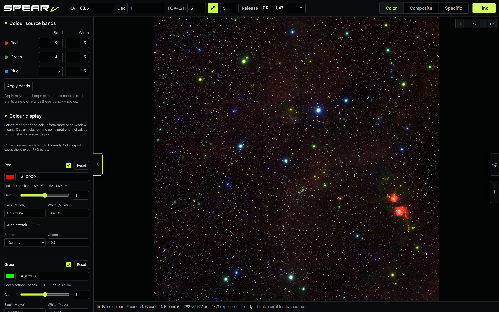
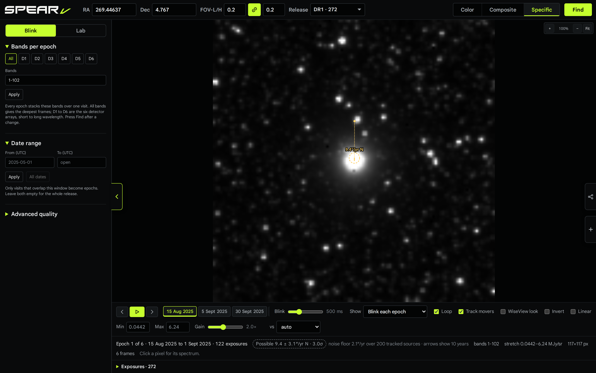
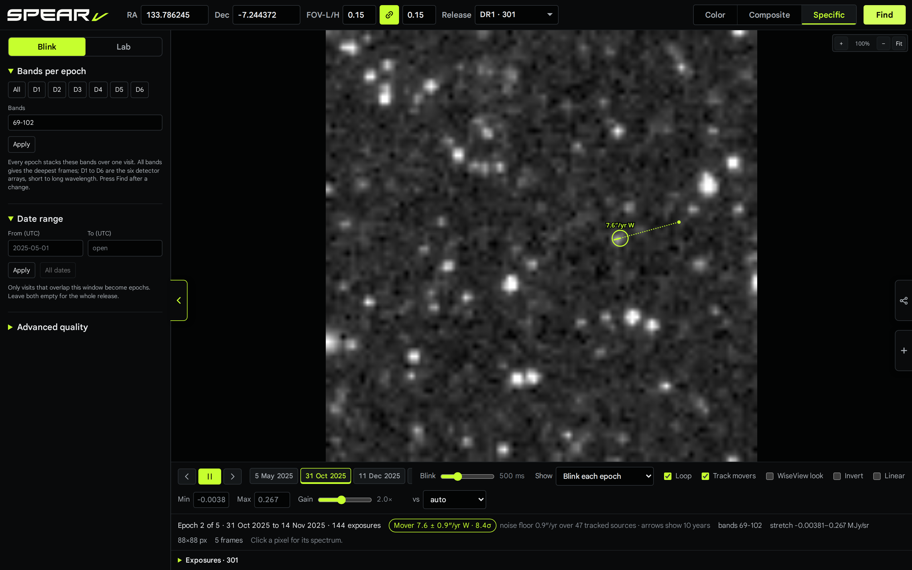
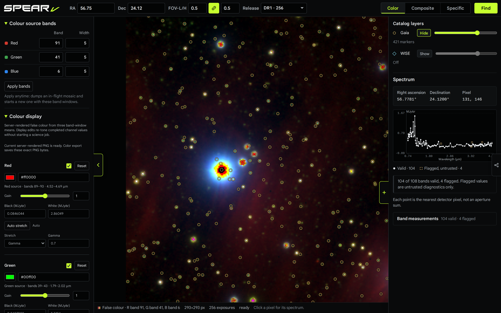
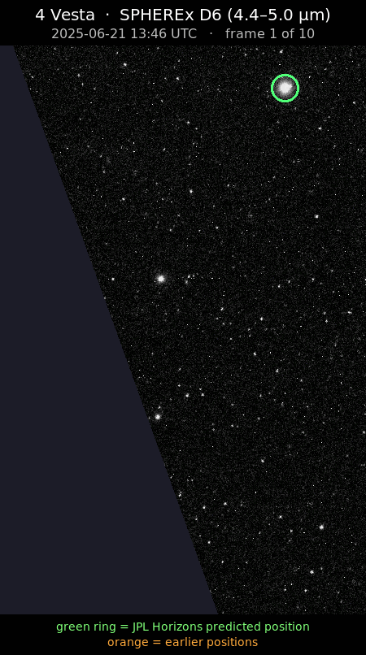

Hey! Please do not exclude the work from global judging due to this commit.

I have not edited the project itself in any way, shape or form since the hackathon deadline; every commit after it is only this README and the screenshots. I passed out and could not write the credits in time.

We picked the name SPEARv since grasping a point in the sky is like hitting a target, like bow and arrow, but this felt bigger, so we went with a spear. V is there for Visual, or Visualization. It is styled SPEAR uppercase, v lowercase to match SPHEREx.

I worked hard on making SPEARv functional and comfortable over the two days of the challenge, and I hope that it'll be beneficial to you (NASA), or to anybody else.

You can check it out at https://mango.forces.quest. It'll load up SPEARv with some default settings. Although I intend to polish this project up as a portfolio piece, the served project at this URL will be the project finished during the competition. The main branch will have the competition work, while for future stuff I will make another branch (probably "next").

I am committing to serving the app for a month, with full compute backing for comfortable tests. If you, the judges, will see this work: fields under about 1° are light, so test away. Larger fields are heavy, so please avoid running several big Finds (10°+) at the same time, and at the very large scales (25° FOV or so) please do not launch more than 1 Find at a time (across tabs or different judges).

Here are some screenshots!

*Orion complex in false color, 5 degree field, 1471 exposures. The M42 core glows red at lower right. R, G and B are bands 91, 41 and 6.*

*Track movers flags candidates, not confirmed discoveries. Barnard's Star caught as "Possible 9.4 ± 3.1″/yr N" (catalog proper motion ~10.4″/yr N).*

*WISE 0855, a cold brown dwarf, across 5 visits. Track movers fits 7.6 ± 0.9″/yr W at 8.4σ (catalog ~8.1″/yr W). Bands 69 to 102, where cold brown dwarfs are brightest.*

*Asteroid 4 Vesta crossing a 1.3° field over 21 to 30 June 2025: ten single SPHEREx exposures (detector D6, 4.4 to 5.0 µm) rendered by the SPEARv engine. The green ring is where NASA JPL Horizons predicts Vesta at each exposure time, and it lands on the bright dot in every frame, while the stars stay put.*

Now... let's discuss the brief!

Objective:

Your challenge is to create a public-facing web tool to display images of the sky from the SPHEREx mission, making it easy for anyone to quickly see how they change over time. Users will enter the coordinates of a patch of sky (Right Ascension and declination). Your tool will display a series of images of that patch like a little video, making it easy to spot moving objects. - Done as Specific mode (Blink). Each visit becomes one calibrated frame, and they play in time order like a little video, with play/pause, loop and blink speed.

Test your tool on Barnard's Star, Epsilon Indi B (a pair of brown dwarfs orbiting a star), WISE 0855 (a fast-moving brown dwarf Right Ascension 08h55m10.831s, declination -7d14m42.53s), and variable stars RW Aurigae and R Draconis. - Done, you can type RA, Dec and FOV for these to see for yourself, or just open these and press Find:

- Barnard's Star: https://mango.forces.quest/?ra=269.44637&dec=4.767&fov_l=0.2&fov_h=0.2&mode=specific&dr=dr1
- Epsilon Indi B: https://mango.forces.quest/?ra=331.0963&dec=-56.8005&fov_l=0.15&fov_h=0.15&mode=specific&dr=dr1
- WISE 0855 (bands 69-102, where the cold brown dwarf shows best): https://mango.forces.quest/?ra=133.786245&dec=-7.244372&fov_l=0.15&fov_h=0.15&mode=specific&dr=dr1&bands=69-102
- RW Aurigae: https://mango.forces.quest/?ra=76.956&dec=30.401&fov_l=0.2&fov_h=0.2&mode=specific&dr=dr1
- R Draconis: https://mango.forces.quest/?ra=248.167&dec=66.755&fov_l=0.2&fov_h=0.2&mode=specific&dr=dr1

Potential Considerations

New SPHEREx data is arriving fast! Make sure to design a tool that's easy to update with the latest data releases. - Worked hard on this one! We have a little system, sort of a.. "library and librarian" let's call it LAL. What LAL does is it lists the NASA S3 bucket, reads only the FITS headers (coordinates, WCS, release, detector, time, quality) and organizes them into a table that points at the real S3 objects. Every 6 hours it re-lists the bucket; if a file is modified, it updates it, if a new one is added, it adds it. So, within 6h of the data spawning on their S3 mirror, our app should pick it up! DR1, QR2 and QR3 are all in there right now.

Think creatively about how to display those 102 infrared bands so users can take advantage of them to make new discoveries! For example, it may make sense to separately add together all the data taken by each of the six detector arrays to improve the signal-to-noise in the images you display. Extra kudos if your tool can generate spectra on the fly. - This one is why we added multiple action modes: color, composite and specific. Color makes it.. colored. Of course (three band windows as RGB). Composite stacks the bands into one deep greyscale image. Specific stacks each visit into one frame, either all bands or one detector array (D1 to D6, short to long wavelength), and blinks them. Specific also allows you to combine frames comfortably and later use the combined result as "sectors" (noise-weighted average: inverse-variance mean within each band, then an equal-weight mean across the selected bands, to improve SNR), then play them back as video chronologically. Spectra: click any pixel and you get its spectrum across all 102 bands, on the fly.

It may help users discover moving objects if they have the options to add together or subtract images taken at different times. - Implemented: minus previous, minus first, all frames added, half-and-half overlay, swipe compare, motion glow (|A−B|), and track movers, which fits position against time across epochs and draws the motion arrows. Track movers needs 4+ epochs; with fewer, you blink and subtract by eye.

Let users choose the field of view! Larger fields of view can make it possible to track faster-moving sources, at the cost of longer data transfer times. - Done, FOV is yours to pick (up to 30°). We tested up to FOV of 25, but that is very taxing, in our test it pulled around 288 GB of data, so multi frame is going to be hard. I think multi frame of say.. 10 FOV should be fine tho!

Users could benefit from having the option to overlay astronomical data from other telescopes, such as the Gaia mission or the WISE mission. - Done! But not as directly placing images on top. What we pull from those missions are catalogs (Gaia DR3, AllWISE), not pictures, so we overlay that data as points (Gaia circles, WISE diamonds). This gives correlation or matching (an object found by Gaia/WISE can be cross examined on SPHEREx).

If you make it possible to query your tool by including coordinates in the URL, users will be able to easily embed it in other websites and projects. - The URL holds your request: field, mode, release, bands, color recipe and display settings, so a link reopens the same view (press Find to render it). Zoom/pan and the Blink/Lab tab are not in the URL. Embedding uses a dedicated /embed page, a minimal image page with CSP frame-ancestors * so any site can iframe it.

It can be useful to display metadata, like contamination flags. - Lab exposure table shows header quality (DQA, streaks, airglow/aurora, FINAST, PSF) and a pass-only filter. QR2 headers lack some of these cards, so those show as Unknown there.

Consider looking for publicly available tools that may help in handling astronomical data, like the Astrophy tools, and in displaying astronomical data, like the Aladin tool developed by the Strasbourg Astronomical Data Center (CDS). - Funny part. Originally when I was building this, I self-rolled the FITS reader and some other heavy stuff, then switched to well maintained libraries instead. Astropy (pinned 8.0.2) does our WCS/SIP sky-to-pixel math, and CFITSIO reads the FITS files. We did not use Aladin; the viewer is our own.

Well. Here's credits -

### Data

| Resource | Provider | URL |
| --- | --- | --- |
| SPHEREx Level-2 FITS (public S3) | NASA IRSA | https://nasa-irsa-spherex.s3.us-east-1.amazonaws.com |
| SPHEREx archive | NASA IRSA | https://irsa.ipac.caltech.edu/data/SPHEREx/ |
| AllWISE catalog (parquet) | NASA IRSA / WISE | https://nasa-irsa-wise.s3.us-west-2.amazonaws.com/wise/allwise/catalogs/p3as_psd/healpix_k5/wise-allwise.parquet |
| WISE / AllWISE mission page | NASA IRSA | https://irsa.ipac.caltech.edu/Missions/wise.html |
| Gaia DR3 source catalog | ESA Gaia | https://cdn.gea.esac.esa.int/Gaia/gdr3/gaia_source/ |
| Gaia Archive | ESA | https://gea.esac.esa.int/archive/ |

### Engine (Rust)

| Library | Role | URL |
| --- | --- | --- |
| [Rust](https://www.rust-lang.org/) | Engine, index, FITS path, extensions | https://www.rust-lang.org/ |
| [Axum](https://github.com/tokio-rs/axum) | HTTP API (engine + index-service) | https://github.com/tokio-rs/axum |
| [Tokio](https://tokio.rs/) | Async runtime | https://tokio.rs/ |
| [Utoipa](https://github.com/juhaku/utoipa) | OpenAPI from Rust routes | https://github.com/juhaku/utoipa |
| [utoipa-axum](https://github.com/juhaku/utoipa) | Axum integration for Utoipa | https://github.com/juhaku/utoipa |
| [Serde](https://serde.rs/) / serde_json | JSON request/response types | https://serde.rs/ |
| [thiserror](https://github.com/dtolnay/thiserror) | Typed errors | https://github.com/dtolnay/thiserror |
| [async-trait](https://github.com/dtolnay/async-trait) | Async traits for sources/extensions | https://github.com/dtolnay/async-trait |
| [Reqwest](https://github.com/seanmonstar/reqwest) (rustls) | HTTP client (S3, index, catalogs) | https://github.com/seanmonstar/reqwest |
| [futures](https://github.com/rust-lang/futures-rs) | Async streams / combinators | https://github.com/rust-lang/futures-rs |
| [Rusqlite](https://github.com/rusqlite/rusqlite) (bundled) | Exposure index DB + Gaia SQLite | https://github.com/rusqlite/rusqlite |
| [CFITSIO](https://heasarc.gsfc.nasa.gov/fitsio/) 4.7.0 (HEASARC) | FITS I/O via private static build (no CFITSIO network) | https://heasarc.gsfc.nasa.gov/fitsio/ |
| [cc](https://github.com/rust-lang/cc-rs) | Build C shim linked to CFITSIO | https://github.com/rust-lang/cc-rs |
| [image](https://github.com/image-rs/image) + [png](https://github.com/image-rs/image-png) | Server PNG encode | https://github.com/image-rs/image |
| [PyO3](https://pyo3.rs/) | Bridge into pinned Python science runtime | https://pyo3.rs/ |
| [ndarray](https://github.com/rust-ndarray/ndarray) | Array types on the Rust science path | https://github.com/rust-ndarray/ndarray |
| [numpy](https://github.com/PyO3/rust-numpy) (Rust crate) | NumPy interop via PyO3 | https://github.com/PyO3/rust-numpy |
| [parquet](https://github.com/apache/arrow-rs) + [arrow-array](https://github.com/apache/arrow-rs) | AllWISE parquet reads | https://github.com/apache/arrow-rs |
| [cdshealpix](https://crates.io/crates/cdshealpix) | HEALPix indexing (Gaia build, WISE cones) | https://crates.io/crates/cdshealpix |
| [flate2](https://github.com/rust-lang/flate2-rs) | Gzip for Gaia bulk CSV.gz | https://github.com/rust-lang/flate2-rs |
| [chrono](https://github.com/chronotope/chrono) | Timestamps | https://github.com/chronotope/chrono |
| [sha2](https://github.com/RustCrypto/hashes) / [md-5](https://github.com/RustCrypto/hashes) / [hex](https://github.com/KokaKiwi/hex-rust) | Hashes and cache keys | https://github.com/RustCrypto/hashes |
| [bytes](https://github.com/tokio-rs/bytes) | Byte buffers | https://github.com/tokio-rs/bytes |
| [tower](https://github.com/tower-rs/tower) | HTTP utilities / tests | https://github.com/tower-rs/tower |
| [tempfile](https://github.com/Stebalien/tempfile) | Temporary files for render paths | https://github.com/Stebalien/tempfile |
| [tokio-util](https://github.com/tokio-rs/tokio) | Async IO helpers | https://github.com/tokio-rs/tokio |

### Science runtime (Python)

| Library | Role | URL |
| --- | --- | --- |
| [Python](https://www.python.org/) | Embedded science runtime (via PyO3) | https://www.python.org/ |
| [NumPy](https://numpy.org/) | Array math for stacking and differences | https://numpy.org/ |
| [Astropy](https://www.astropy.org/) 8.0.2 | WCS/SIP sky-to-pixel transforms | https://www.astropy.org/ |
| [astropy-iers-data](https://github.com/astropy/astropy-iers-data) | Pinned Earth-rotation data for Astropy | https://github.com/astropy/astropy-iers-data |

### Web UI

| Library | Role | URL |
| --- | --- | --- |
| [React](https://react.dev/) | UI | https://react.dev/ |
| [React DOM](https://react.dev/) | DOM renderer | https://react.dev/ |
| [TypeScript](https://www.typescriptlang.org/) | Typed frontend | https://www.typescriptlang.org/ |
| [Vite](https://vite.dev/) | Dev server and production build | https://vite.dev/ |
| [@vitejs/plugin-react](https://github.com/vitejs/vite-plugin-react) | React plugin for Vite | https://github.com/vitejs/vite-plugin-react |
| [openapi-fetch](https://github.com/openapi-ts/openapi-typescript) | Typed HTTP client from OpenAPI | https://github.com/openapi-ts/openapi-typescript |
| [openapi-typescript](https://github.com/openapi-ts/openapi-typescript) | Generate TS types from OpenAPI | https://github.com/openapi-ts/openapi-typescript |

### Host and edge

| Tool | Role | URL |
| --- | --- | --- |
| OCI | Compute host | https://www.oracle.com/cloud/ |
| [Caddy](https://caddyserver.com/) | Reverse proxy and static site | https://caddyserver.com/ |
| [Cloudflare Tunnel](https://developers.cloudflare.com/cloudflare-one/connections/connect-apps/) | Public HTTPS front door | https://developers.cloudflare.com/cloudflare-one/connections/connect-apps/ |
| systemd | Process units for engine, index, web | https://systemd.io/ |

### Method / challenge context

| Resource | URL |
| --- | --- |
| NASA Space Apps Challenge | https://www.spaceappschallenge.org/ |
| Backyard Worlds (citizen motion search reference) | https://www.backyardworlds.org/ |

---
